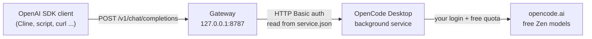
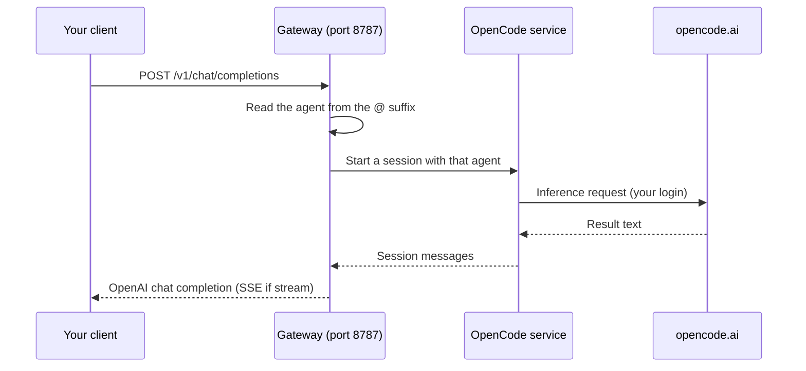
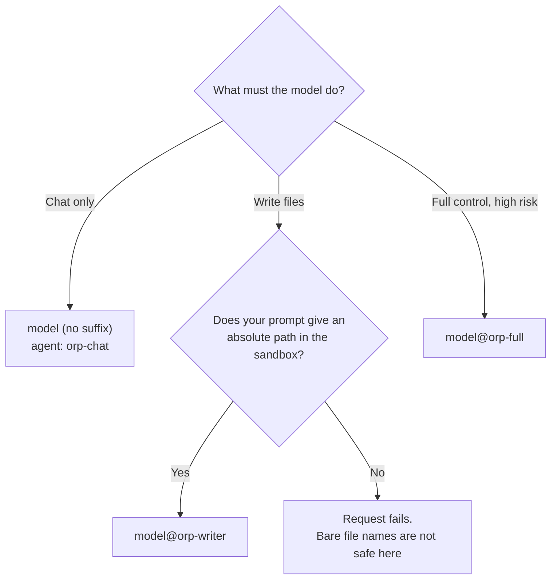
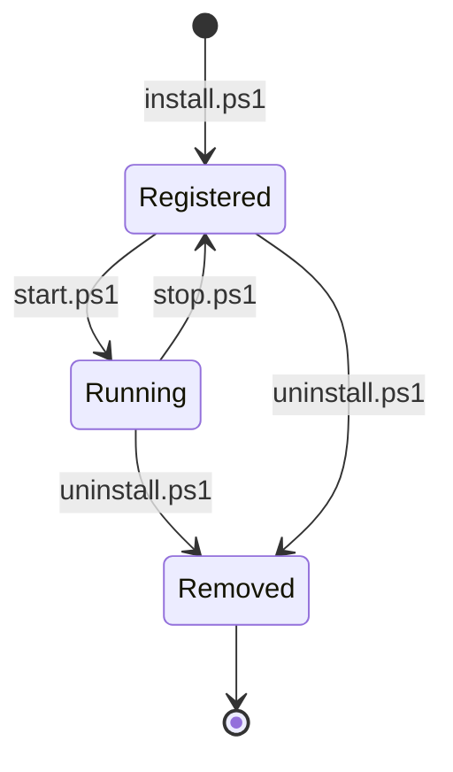
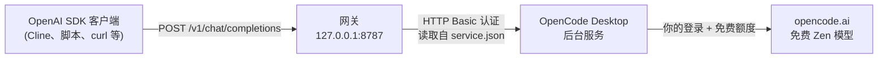
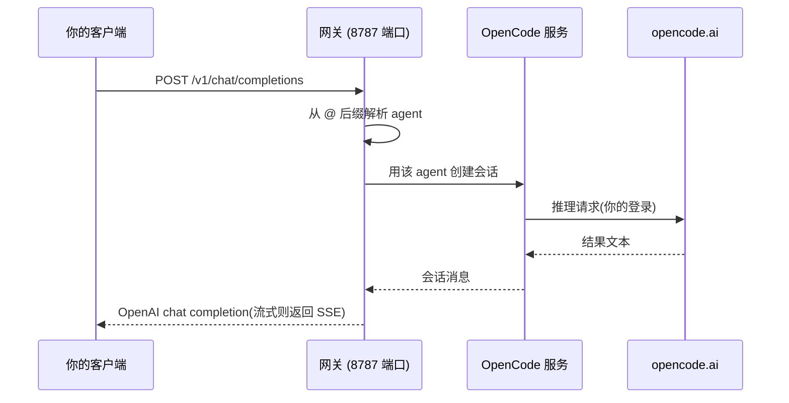

# Opencode-Reverse-Proxy


[跳到中文说明](#中文说明) · [Jump to Chinese](#中文说明)

> **Read this first.** This gateway is for your machine only. By default it checks no API key. The `@orp-full` route lets a model run commands with your user account. Read [Security](#security) before you install.

A local OpenAI-compatible gateway for Windows. You point any OpenAI SDK client at the gateway. The gateway sends your request through the **real OpenCode Desktop service**. The call uses your login and bills to your free Zen quota.

Nothing pretends to be OpenCode. The gateway holds no credentials. It reads the local service registration (`service.json`) and calls the background service in the same way as the app.

---

## How it works





Supported endpoints:

| Endpoint | Purpose |
|---|---|
| `GET /health` | Shows service status and connection data |
| `GET /v1/models` | Lists the free models that OpenCode gives now |
| `GET /v1/models/{id}` | Shows one model object |
| `POST /v1/chat/completions` | Chat completions. Plain and streaming |

---

## Requirements

| You need | Notes |
|---|---|
| Windows 10 or 11 | The scripts are PowerShell |
| Node.js 18 or later | Run `node --version` to check |
| OpenCode Desktop | Installed, running, and signed in. Free models show in the app |

> If the model list in OpenCode shows no free models, your account has no free tier. The gateway cannot change that.

---

## Install

### Option A — install as a skill (recommended)

OpenCode can do all steps for you.

1. Install OpenCode Desktop, start it, and sign in.
2. Tell OpenCode to install the skill. Give it this repository URL:

   ```text
   https://github.com/<your-name>/opencode-reverse-proxy
   ```

   Example prompt:

   ```text
   Install the skill from https://github.com/<your-name>/opencode-reverse-proxy.
   Then start the gateway and run the checks.
   ```

3. The agent copies the skill folder, merges the `orp-*` agents into your OpenCode config, starts the gateway, and runs the end-to-end checks. It reports every result.
4. Point your client at the gateway (see [Client setup](#client-setup)).

### Option B — run the scripts yourself

```powershell
# 1. Write the sandbox and register the agents
powershell -ExecutionPolicy Bypass -File scripts\install.ps1

# 2. Start the gateway (detached, returns in about 2 seconds)
powershell -ExecutionPolicy Bypass -File scripts\start.ps1

# 3. Test the full chain end to end
powershell -ExecutionPolicy Bypass -File scripts\verify.ps1
```

Exit code 0 from `verify.ps1` means all checks passed.

---

## Choose a model and an agent

Append `@<agent>` to a model id. The suffix chooses how much the model can do. Model ids change over time. Do not hardcode them. Query `GET /v1/models`.

| Model spec | Agent | The model can |
|---|---|---|
| `big-pickle` | `orp-chat` (default) | Chat only. Every tool is denied. Reads of `.env`, `.pem`, `.key` are denied |
| `big-pickle@orp-writer` | `orp-writer` | Read and write files. Sandbox only. Absolute paths only |
| `big-pickle@orp-full` | `orp-full` | Everything: whole disk, shell, web. High risk |



The writer sandbox is `%USERPROFILE%\Downloads\Opencode Reverse Proxy`. `install.ps1` can set another path with `-WriterDir`.

> **Absolute paths only.** The gateway sends only your text to the model. The model does not know its working directory. A bare file name makes the model guess, and the sandbox rejects the guess. Example: `write to C:\Users\you\Downloads\Opencode Reverse Proxy\notes.md`.

---

## Client setup

| Setting | Value |
|---|---|
| Base URL | `http://127.0.0.1:8787/v1` |
| API key | Any non-empty value (unless you set `ORP_KEY`) |
| Model | Any id from `GET /v1/models`, with an optional `@agent` suffix |

curl example:

```bash
curl http://127.0.0.1:8787/v1/chat/completions \
  -H "Content-Type: application/json" \
  -H "Authorization: Bearer any-key" \
  -d '{"model":"big-pickle","messages":[{"role":"user","content":"Hello"}]}'
```

Python example:

```python
from openai import OpenAI

client = OpenAI(base_url="http://127.0.0.1:8787/v1", api_key="any-key")
reply = client.chat.completions.create(
    model="big-pickle",
    messages=[{"role": "user", "content": "Hello"}],
)
print(reply.choices[0].message.content)
```

More clients and unsupported routes: `references/client-setup.md`.

---

## Commands

| Script | Purpose | Options |
|---|---|---|
| `scripts\install.ps1` | Make the sandbox, merge the agents into the global config, check registration | `-WriterDir`, `-NoRestart` |
| `scripts\start.ps1` | Start the gateway detached and wait for health | `-Port`, `-Key`, `-DefaultModel` |
| `scripts\stop.ps1` | Stop the gateway | `-Port` |
| `scripts\verify.ps1` | Full end-to-end check | `-InstallOnly`, `-SkipWriteTest`, `-Model`, `-Port` |
| `scripts\uninstall.ps1` | Stop the gateway and remove the agents | `-IncludeLegacy` |

> With `-NoRestart`, the installer never restarts the OpenCode service. Use it if you do not want OpenCode to close your open sessions. Then restart OpenCode Desktop yourself.



---

## Environment variables

| Variable | Default | Meaning |
|---|---|---|
| `ORP_PORT` | `8787` | Listen port |
| `ORP_HOST` | `127.0.0.1` | Listen address. Do not set `0.0.0.0` |
| `ORP_KEY` | none | If set, clients must send `Authorization: Bearer <key>` |
| `ORP_AGENT` | `orp-chat` | Agent for model ids with no `@` suffix |
| `ORP_AGENTS` | `orp-chat,orp-writer,orp-full` | Allowlist for the `@` suffix |
| `ORP_DEFAULT_MODEL` | first available | Model for calls with no model |
| `ORP_TIMEOUT_MS` | `300000` | Time limit per request |
| `ORP_KEEP_SESSIONS` | off | `1` keeps the OpenCode sessions |
| `ORP_STRIP_TOOLS` | `1` (set by `start.ps1`) | Accept `tools` requests. Answer as text |
| `ORP_SERVICE_JSON` | `%USERPROFILE%\.local\state\opencode\service.json` | Path to the service registry |

---

## Limitations

- **No tool calling.** Requests with `tools` or `tool_choice` are accepted, but the gateway answers as plain text. It marks the reply with `reverse_proxy.tools_ignored: true` (streaming: header `X-ORP-Tools-Ignored: 1`). It never fakes `tool_calls`. Clients that need real tool calls, such as the Cline tool panel, do not work. Use the `@orp-writer` route for file work.
- **`@orp-writer` needs absolute paths.** See [Choose a model and an agent](#choose-a-model-and-an-agent).
- **`glob` is inert in the sandbox.** In OpenCode V2, the `glob` rule matches the pattern, not a directory. So a path-shaped rule never matches. The model can still read and write with explicit paths. This is a known, documented limit.
- **Only chat completions.** `/v1/responses`, `/v1/messages`, and `/v1/embeddings` give a clear 400 error.
- **No images.** Image input becomes `[binary image content omitted]`.
- **Quota errors pass through.** The gateway does not retry 429 or 403 errors. It reports them as they come.

---

## Security

> ⚠️ **Warning.** By default, this gateway checks no API key. Every local process can call it. Through `@orp-full` a model can read and write the whole disk and run shell commands with your user account. `127.0.0.1` does not protect you here, because every local process can reach `127.0.0.1`.

Reduce the risk:

1. Start the gateway with a key:

   ```powershell
   powershell -ExecutionPolicy Bypass -File scripts\start.ps1 -Key "a-long-random-string"
   ```

2. If you do not need `orp-full`, delete its entry from `agents.json` before you install.
3. Keep `ORP_HOST` at its default.
4. Use `@orp-full` only for tasks that you control.

The exact agent rule model: `references/permissions.md`.

---

## Troubleshooting

| Symptom | First action |
|---|---|
| `/health` fails | Open the OpenCode Desktop app. Make sure it runs and you are signed in |
| `403` or `429` from a model | Your free quota is gone or the model is busy. Try another model |
| Model list is empty | Check that free models show inside the app |
| Sandbox rejects a write | Give an absolute path inside the sandbox |

The skill includes a symptom-by-symptom guide: `references/troubleshooting.md`.

---

## Project layout

```text
opencode-reverse-proxy/
├── SKILL.md                   <- instructions for an OpenCode agent
├── README.md
├── gateway.mjs                <- the gateway
├── agents.json                <- agent templates
├── scripts/
│   ├── lib.ps1                <- shared helpers
│   ├── install.ps1
│   ├── start.ps1
│   ├── stop.ps1
│   ├── verify.ps1
│   └── uninstall.ps1
└── references/
    ├── client-setup.md        <- more clients and unsupported routes
    ├── permissions.md         <- the exact agent rule model
    └── troubleshooting.md     <- symptom-by-symptom fixes
```

---

## Uninstall

```powershell
powershell -ExecutionPolicy Bypass -File scripts\uninstall.ps1
```

Then delete the skill folder, the sandbox folder, and `%LOCALAPPDATA%\opencode-reverse-proxy`.

---

## Built with AI assistance

This project was made with AI assistance
- The gateway code, the PowerShell scripts, and the agent definitions came from work with an AI coding agent. The AI wrote most of the code.
- A human reviewed the design, ran the checks, and tested the full chain. The human is responsible for this repository.
- Treat the output of the AI like any pull request: review it before you run it. Read the scripts. They are short.

---

# 中文说明

> **安装前必读。** 这个网关只能在本机使用。默认它不检查任何 API key,任何本地程序都能调用它。`@orp-full` 路由会让模型以你的用户身份执行命令。安装前请先阅读「安全」一节。

## 这是什么

一个运行在 Windows 上的本地 OpenAI 兼容网关。任何 OpenAI SDK 客户端都可以连接它。网关把请求交给**真正的 OpenCode Desktop 后台服务**转发,调用使用你自己的登录状态,费用记在你的免费 Zen 额度里。

它不伪造 OpenCode 身份。网关自身不保存任何凭据,它读取本地服务注册文件(`service.json`),用和桌面端应用相同的方式调用后台服务。

**这是一个 AI 辅助开发的项目**:大部分代码由 OpenCode 中的 AI 编码智能体完成,人工负责审查设计、运行检查并测试完整链路(详见文末「AI 辅助声明」)。

## 工作原理





支持的端点:

| 端点 | 用途 |
|---|---|
| `GET /health` | 显示服务状态和连接信息 |
| `GET /v1/models` | 列出 OpenCode 当前的免费模型 |
| `GET /v1/models/{id}` | 返回单个模型对象 |
| `POST /v1/chat/completions` | Chat completions,支持普通和流式 |

## 环境要求

| 需要什么 | 说明 |
|---|---|
| Windows 10 或 11 | 脚本都是 PowerShell |
| Node.js 18 或更高 | 运行 `node --version` 检查 |
| OpenCode Desktop | 已安装、正在运行、已登录,应用内能看到免费模型 |

> 如果 OpenCode 的模型列表里没有免费模型,说明你的账号没有免费额度,网关无法绕过这一点。

## 安装

### 方式 A —— 作为 skill 安装(推荐)

OpenCode 可以帮你完成全部步骤。

1. 安装并打开 OpenCode Desktop,登录。
2. 让 OpenCode 安装这个 skill,把下面的仓库网址给它:

   ```text
   https://github.com/<你的用户名>/opencode-reverse-proxy
   ```

   示例提示词:

   ```text
   请从 https://github.com/<你的用户名>/opencode-reverse-proxy 安装这个 skill。
   然后启动网关并运行检查。
   ```

3. 智能体会复制 skill 目录,把 `orp-*` 三个 agent 合并进你的 OpenCode 全局配置,启动网关,并逐项运行端到端检查,然后汇报结果。
4. 把客户端指向网关(见「客户端配置」)。

### 方式 B —— 自己运行脚本

```powershell
# 1. 建立 sandbox 并注册 agent
powershell -ExecutionPolicy Bypass -File scripts\install.ps1

# 2. 启动网关(脱离终端运行,约 2 秒返回)
powershell -ExecutionPolicy Bypass -File scripts\start.ps1

# 3. 端到端验证完整链路
powershell -ExecutionPolicy Bypass -File scripts\verify.ps1
```

`verify.ps1` 退出码为 0 表示全部检查通过。

## 选择模型和 agent

在模型 id 后面加 `@<agent>` 后缀来决定模型的权限。模型 id 会变化,不要硬编码,用 `GET /v1/models` 查询。

| 模型写法 | Agent | 模型能做什么 |
|---|---|---|
| `big-pickle` | `orp-chat`(默认) | 只能对话,所有工具都被拒绝;读取 `.env`、`.pem`、`.key` 也被拒绝 |
| `big-pickle@orp-writer` | `orp-writer` | 读写文件,仅限 sandbox,必须用绝对路径 |
| `big-pickle@orp-full` | `orp-full` | 无限制:整盘读写、shell、联网,高风险 |

sandbox 路径是 `%USERPROFILE%\Downloads\Opencode Reverse Proxy`,`install.ps1` 可以用 `-WriterDir` 改成别的路径。

> **必须用绝对路径。** 网关只把对话文本发给模型,模型不知道自己的工作目录。只给文件名会让模型猜测路径,然后被 sandbox 拒绝。示例:`write to C:\Users\you\Downloads\Opencode Reverse Proxy\notes.md`。

## 客户端配置

| 设置 | 值 |
|---|---|
| Base URL | `http://127.0.0.1:8787/v1` |
| API key | 任意非空值(除非你设置过 `ORP_KEY`) |
| Model | `GET /v1/models` 里的任意 id,可加 `@agent` 后缀 |

```bash
curl http://127.0.0.1:8787/v1/chat/completions \
  -H "Content-Type: application/json" \
  -H "Authorization: Bearer any-key" \
  -d '{"model":"big-pickle","messages":[{"role":"user","content":"Hello"}]}'
```

```python
from openai import OpenAI

client = OpenAI(base_url="http://127.0.0.1:8787/v1", api_key="any-key")
reply = client.chat.completions.create(
    model="big-pickle",
    messages=[{"role": "user", "content": "Hello"}],
)
print(reply.choices[0].message.content)
```

## 命令

| 脚本 | 用途 | 选项 |
|---|---|---|
| `scripts\install.ps1` | 建 sandbox,把 agent 合并进全局配置,验证注册 | `-WriterDir`、`-NoRestart` |
| `scripts\start.ps1` | 脱离终端启动网关并等待健康检查 | `-Port`、`-Key`、`-DefaultModel` |
| `scripts\stop.ps1` | 停止网关 | `-Port` |
| `scripts\verify.ps1` | 完整端到端检查 | `-InstallOnly`、`-SkipWriteTest`、`-Model`、`-Port` |
| `scripts\uninstall.ps1` | 停止网关并移除 agent | `-IncludeLegacy` |

> `-NoRestart` 让安装脚本永不重启 OpenCode 服务,避免关掉你打开中的会话;之后请自己在普通 PowerShell 里重启 OpenCode Desktop。

## 环境变量

| 变量 | 默认值 | 含义 |
|---|---|---|
| `ORP_PORT` | `8787` | 监听端口 |
| `ORP_HOST` | `127.0.0.1` | 监听地址,**不要**设 `0.0.0.0` |
| `ORP_KEY` | 无 | 设置后客户端必须发送 `Authorization: Bearer <key>` |
| `ORP_AGENT` | `orp-chat` | 模型没有 `@` 后缀时使用的 agent |
| `ORP_AGENTS` | `orp-chat,orp-writer,orp-full` | `@` 后缀的允许列表 |
| `ORP_DEFAULT_MODEL` | 第一个可用模型 | 调用没指定模型时使用 |
| `ORP_TIMEOUT_MS` | `300000` | 单请求时限(毫秒) |
| `ORP_KEEP_SESSIONS` | 关 | `1` 表示保留 OpenCode 会话 |
| `ORP_STRIP_TOOLS` | `1`(`start.ps1` 设置) | 接受 `tools` 请求,按纯文本回答 |
| `ORP_SERVICE_JSON` | `%USERPROFILE%\.local\state\opencode\service.json` | 服务注册文件路径 |

## 限制

- **不支持工具调用。** 带 `tools` 或 `tool_choice` 的请求会被接受,但网关按纯文本回答,并标记 `reverse_proxy.tools_ignored: true`(流式则加响应头 `X-ORP-Tools-Ignored: 1`)。它不会伪造 `tool_calls`。需要真实工具调用的客户端(例如 Cline 的工具面板)无法工作;写文件请走 `@orp-writer` 路由。
- **`@orp-writer` 必须用绝对路径。** 见「选择模型和 agent」。
- **sandbox 里 `glob` 无效。** OpenCode V2 中 `glob` 权限匹配的是模型请求的模式本身,不是目录路径,所以路径形规则永远匹配不上。模型仍然能用显式路径读写文件。这是已知且有意保留的限制。
- **只有 chat completions。** `/v1/responses`、`/v1/messages`、`/v1/embeddings` 返回明确的 400 错误。
- **不转发图片。** 图片输入会变成 `[binary image content omitted]`。
- **配额错误原样返回。** 网关不重试 429/403,如实报告。

## 安全

> ⚠️ **注意。** 默认情况下网关不检查 API key,本机所有进程都能调用它。通过 `@orp-full`,模型可以以你的用户身份读写整块磁盘并执行 shell 命令。绑定 `127.0.0.1` 在这里保护不了你,因为本机任何进程都能连上 `127.0.0.1`。

降低风险的方法:

1. 带 key 启动网关:

   ```powershell
   powershell -ExecutionPolicy Bypass -File scripts\start.ps1 -Key "一长串随机字符串"
   ```

2. 如果你不需要 `orp-full`,在安装前把它的条目从 `agents.json` 里删掉。
3. 保持 `ORP_HOST` 为默认值。
4. 只在你能完全掌控的任务上使用 `@orp-full`。

完整的 agent 权限规则见 `references/permissions.md`。

## 故障排查

| 症状 | 第一步 |
|---|---|
| `/health` 失败 | 打开 OpenCode Desktop 应用,确认它在运行且你已登录 |
| 模型报 `403` 或 `429` | 免费额度用完或模型繁忙,换一个模型试试 |
| 模型列表为空 | 检查应用内是否能看到免费模型 |
| sandbox 拒绝写入 | 提供 sandbox 内的绝对路径 |

skill 自带逐症状排查指南:`references/troubleshooting.md`。

## 卸载

```powershell
powershell -ExecutionPolicy Bypass -File scripts\uninstall.ps1
```

然后删除 skill 文件夹、sandbox 文件夹和 `%LOCALAPPDATA%\opencode-reverse-proxy`。

## AI 辅助声明

本项目在借助 AI 开发完成。

- 网关代码 `gateway.mjs`、PowerShell 脚本和 agent 定义主要由 AI 编码智能体结合人工编写完成。
- 人工负责审查设计、运行 `verify.ps1`、测试完整链路,并对本仓库的所有内容负责。
- 请把 AI 产出当作普通提交来对待:运行前先审读代码。脚本都很短,通读一遍很快。
